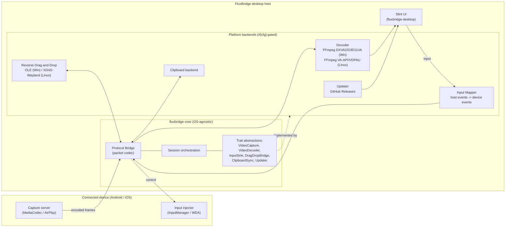

# FluxBridge architecture blueprint

FluxBridge separates a portable application core from the operating-system and
vendor integrations it drives. The core owns the wire protocol and the
orchestration logic; everything that touches a platform API or a vendor library
sits behind a trait defined in `fluxbridge-core` and is implemented by a
swappable backend. This is what lets the same codebase target Windows first and
then port to Linux (Wayland/X11) without rewriting the application logic, and
what lets the whole workspace build and test on a headless Linux CI host using
stub backends.

## Component diagram

## Modules

### Capture
Acquires an encoded video stream from the device. On Android this is the
`app_process` capture server using `SurfaceControl` + `MediaCodec` to produce
H.264/H.265 delivered over an ADB socket; on iOS it is an AirPlay mirroring
receiver or an RTP H.264 stream. In the core this is the `VideoCapture` trait,
which yields `EncodedFrame` values and never exposes transport details.

### Decoder
Turns encoded frames into displayable pixels. Production backends use FFmpeg
with hardware acceleration: DXVA2 / D3D11VA on Windows, VA-API / VDPAU on Linux.
Modeled by the `VideoDecoder` trait so no FFmpeg symbols leak into the portable
core; the headless stubs return `NotImplemented`.

### Input Mapper
Translates host input (mouse, keyboard, touch/pen) into the protocol's
`MouseEvent`, `KeyEvent` and `TouchEvent` packets, handling coordinate scaling
between the host window and the device resolution. The device-facing delivery is
the `InputSink` trait (Android `InputManager`, iOS WebDriverAgent).

### Protocol Bridge
The heart of the core: the binary packet codec (`protocol.rs`). It frames and
parses every packet type on every transport, so media, input, clipboard and file
traffic share one well-defined wire format. See
[`PROTOCOL.md`](PROTOCOL.md) for the exact layout.

### Reverse Drag-and-Drop
Coordinates bi-directional, context-aware drag-and-drop. PC to phone injects a
file into the device's foreground app; phone to PC starts a native host drag.
The host side is the `DragDropBridge` trait: Windows uses OLE `IDataObject` /
`IDropSource`; Linux uses XDnD (X11) or `wl_data_device` (Wayland).

### Updater
Checks GitHub Releases on startup, offers the user "update now" or "later",
then downloads and applies the new build. Modeled by the `Updater` trait; the
concrete GitHub implementation lands in the `fluxbridge-updater` crate.

## Android v1: the scrcpy-driven path

The shipped v1 Android path does not wait for a bespoke FluxBridge capture
server. Instead the desktop drives the upstream, MIT-licensed scrcpy server over
adb, which is the pragmatic way to get a reliable, low-latency H.264 stream and
input injection today. The desktop responsibilities live in feature-independent,
unit-tested modules:

- `crates/desktop/src/adb.rs` builds the adb command lines (discovery, `push`,
  `forward`, `connect`, `pair`, `mdns services`, and `app_process` launch) as
  pure functions, and parses `adb mdns services` output into typed services.
- `crates/desktop/src/provision.rs` auto-provisions adb: when it is not already
  installed, FluxBridge downloads Google's official platform-tools into a
  per-user data dir and uses the bundled copy directly, so a non-technical user
  never installs the SDK or edits PATH. The download/extract/path logic is pure
  and tested offline with a fake transport and a synthetic in-memory zip.
- `crates/desktop/src/wireless_ui.rs` + `devices.rs` implement the Android 11+
  wireless-debugging flow: discover devices over mDNS (by driving `adb mdns
  services`), pair a new device once with the 6-digit code the phone shows
  (`adb pair`), `adb connect` on the dynamic mDNS endpoint, and remember the
  device in a small JSON file so a returning user auto-reconnects silently. The
  one-time pairing code is required by Android and read off the phone on the
  first pairing only (it is shown only while the "Pair device with pairing code"
  screen is open, so the PC cannot trigger that prompt remotely). The Slint
  "Connect wirelessly" panel wires this on a worker thread, mirroring the
  updater's worker-thread + channel + timer pattern. Developer Options >
  Wireless debugging is a hard requirement: full mirror plus input injection
  over Wi-Fi needs adb, which needs Wireless debugging, the same constraint
  scrcpy and Vysor have. A view-only MediaProjection app (no input, per-session
  capture prompt) or vendor tools (Samsung DeX, Phone Link) are the only
  adb-free alternatives and are out of scope. The in-app Help and the README
  explain this to the user, and a "Stop mirroring" control ends a session and
  returns to the menu without quitting.
- `crates/desktop/src/scrcpy.rs` parses and encodes the scrcpy wire format: the
  one-shot video stream header, the length-prefixed H.264 access units, and the
  scrcpy control messages for input.
- `crates/desktop/src/pipeline.rs` orchestrates the lifecycle: locate adb, push
  and launch the server, set up the forward, connect the video socket and drive
  the scrcpy stream (`scrcpy::stream_av_packets`) into the decoder, open the
  scrcpy control socket and build the input sink from the device resolution, and
  tear everything down, reporting status over a channel (so a windowed Windows
  build surfaces "adb not found" or "no device" without a console).

This path feeds the same `VideoDecoder` trait abstraction described above: the
scrcpy access units are fed straight to the decoder (the `decode` feature's
FFmpeg backend, or the headless `StubDecoder`), which turns them into pixels for
the Slint UI. The scrcpy sockets do NOT go through the FluxBridge `0xFB`
`Connection` / `run_decode_loop` path; that path is retained only for a future
FluxBridge-native server.

### Verification status (be honest)

The transport (`adb.rs`), the scrcpy framing and control encoders (`scrcpy.rs`),
the pipeline's scrcpy-driven video path and control-sink handoff
(`pipeline.rs`), and the decode seam (`decode_loop.rs`) are IMPLEMENTED and
unit-tested headlessly: the stream driver runs against synthetic in-memory
streams with a fake decoder, and the control sink is driven end to end through a
fake writer. What has NOT been exercised here is a live device: the headless
Linux CI host has no Android phone, no adb, no FFmpeg development libraries, and
no display, so real end-to-end mirroring and input injection are wired but must
be verified by the user on Windows with a phone attached (build
`--features gui,decode`, ship the scrcpy server jar next to the `.exe`, connect a
device, and click Start). Do not read "implemented" as "field-verified on a
device" for the live streaming path.

### Two wire formats, kept distinct

- scrcpy sockets (the v1 video + control path) use scrcpy's OWN framing, encoded
  and parsed in `scrcpy.rs`. They do NOT carry the FluxBridge `0xFB` packet
  header.
- The FluxBridge `0xFB` protocol in `crates/core/src/protocol.rs` (see
  [`PROTOCOL.md`](PROTOCOL.md)) is retained for a future FluxBridge-native
  server and for transport-agnostic input/clipboard/file framing. It is not used
  on scrcpy sockets. The two formats never share a socket, so there is no
  ambiguity about which parser applies.

## How the core stays decoupled

- `fluxbridge-core` depends only on pure-Rust, link-free crates (`thiserror`,
  `byteorder`, `bitflags`). It never pulls in FFmpeg, ADB, OLE or
  libimobiledevice bindings.
- Each OS/vendor capability is a trait. Backends live behind `#[cfg(windows)]`
  / `#[cfg(unix)]` and are selected in `platform/mod.rs`.
- Stub backends implement every trait with a no-op or `NotImplemented` error, so
  the workspace compiles and the test suite runs on any host.
- The Slint UI crate depends on the core's traits, not on concrete backends, so
  UI and application logic are testable without a device present.
