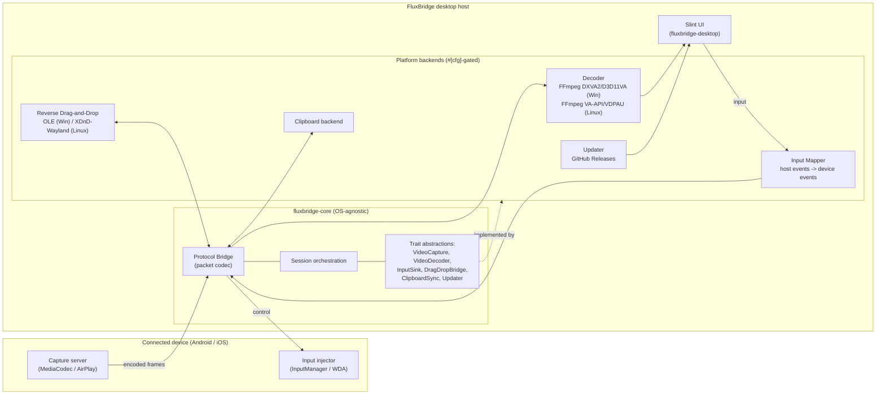

# FluxBridge architecture blueprint

FluxBridge separates a portable application core from the operating-system and
vendor integrations it drives. The core owns the wire protocol and the
orchestration logic; everything that touches a platform API or a vendor library
sits behind a trait defined in `fluxbridge-core` and is implemented by a
swappable backend. This is what lets the same codebase target Windows first and
then port to Linux (Wayland/X11) without rewriting the application logic, and
what lets the whole workspace build and test on a headless Linux CI host using
stub backends.

## Component diagram

## Modules

### Capture
Acquires an encoded video stream from the device. On Android this is the
`app_process` capture server using `SurfaceControl` + `MediaCodec` to produce
H.264/H.265 delivered over an ADB socket; on iOS it is an AirPlay mirroring
receiver or an RTP H.264 stream. In the core this is the `VideoCapture` trait,
which yields `EncodedFrame` values and never exposes transport details.

### Decoder
Turns encoded frames into displayable pixels. Modeled by the `VideoDecoder`
trait so no FFmpeg symbols leak into the portable core.

The shipped v1 decode path (option 2b) is a NATIVE scrcpy decode engine rather
than a from-scratch Rust reimplementation. FluxBridge previously reimplemented
scrcpy's client-side demux/decode in pure Rust and hit an unresolved
`send_packet: invalid data found when processing input`, caused by delivering
the SPS/PPS config access unit through a separate `configure()` call instead of
prepending it to the next media packet the way scrcpy does. The native engine
fixes this by building on scrcpy's proven algorithm:

- `native/scrcpy-decode/vendor/packet_merger.{c,h}` is vendored verbatim from
  scrcpy v5.0.1 (Apache-2.0, include-only trim); it remembers a config packet
  and prepends it to the next media packet so the decoder receives one
  `[SPS/PPS][keyframe]` Annex-B `AVPacket`.
- `native/scrcpy-decode/fb_decoder.c` reimplements scrcpy's `avcodec_send_packet`
  + `avcodec_receive_frame` loop (with `AV_CODEC_FLAG_LOW_DELAY`) and the
  swscale-to-RGBA conversion, exposed over a thin opaque C ABI (`fb_decoder.h`).
- `crates/scrcpy-decode-sys` is the FFI crate; its `build.rs` compiles that C
  with the `cc` crate and links the shared FFmpeg (avcodec/avformat/avutil/
  swscale) from `FFMPEG_DIR`, but ONLY under its `build-native` feature so a
  default build is a clean no-op.
- `crates/desktop/src/decode_loop.rs::NativeScrcpyDecoder` implements
  `VideoDecoder` over that FFI (behind the `native-decode` cargo feature), is
  `Send`, and emits `DecodedFrame{ pixel_format: "rgba", data.len() == w*h*4 }`,
  which the Slint UI (`ui.rs::attach_frame_sink` + `decoded_frame_to_image`)
  renders via `SharedPixelBuffer<Rgba8Pixel>` into the EXISTING in-window
  `frame` surface. There is no separate SDL/scrcpy window.

Feature selection and precedence (`pipeline.rs`): `native-decode` wins over the
older pure-Rust `decode` (ffmpeg-next) fallback, which in turn wins over the
headless `StubDecoder`. Both FFmpeg-backed features are OFF by default and NOT
implied by `gui`, so the headless Linux host (no FFmpeg, no display) keeps the
`StubDecoder` and builds/tests/clippy stay green with zero native linkage. The
`decode` path is kept in the tree as a fallback until the native engine is
validated on Windows CI and by the user; the shipped Windows release builds
`--features gui,native-decode`.

### Input Mapper
Translates host input (mouse, keyboard, touch/pen) into the protocol's
`MouseEvent`, `KeyEvent` and `TouchEvent` packets, handling coordinate scaling
between the host window and the device resolution. The device-facing delivery is
the `InputSink` trait (Android `InputManager`, iOS WebDriverAgent).

### Protocol Bridge
The heart of the core: the binary packet codec (`protocol.rs`). It frames and
parses every packet type on every transport, so media, input, clipboard and file
traffic share one well-defined wire format. See
[`PROTOCOL.md`](PROTOCOL.md) for the exact layout.

### Reverse Drag-and-Drop
Coordinates bi-directional, context-aware drag-and-drop. PC to phone injects a
file into the device's foreground app; phone to PC starts a native host drag.
The host side is the `DragDropBridge` trait: Windows uses OLE `IDataObject` /
`IDropSource`; Linux uses XDnD (X11) or `wl_data_device` (Wayland).

### Updater
Checks GitHub Releases on startup, offers the user "update now" or "later",
then downloads and applies the new build. Modeled by the `Updater` trait; the
concrete GitHub implementation lands in the `fluxbridge-updater` crate.

## Android v1: the scrcpy-driven path

The shipped v1 Android path does not wait for a bespoke FluxBridge capture
server. Instead the desktop drives the upstream, MIT-licensed scrcpy server over
adb, which is the pragmatic way to get a reliable, low-latency H.264 stream and
input injection today. The desktop responsibilities live in feature-independent,
unit-tested modules:

- `crates/desktop/src/adb.rs` builds the adb command lines (discovery, `push`,
  `forward`, `connect`, `pair`, `mdns services`, and `app_process` launch) as
  pure functions, and parses `adb mdns services` output into typed services.
- `crates/desktop/src/provision.rs` auto-provisions adb: when it is not already
  installed, FluxBridge downloads Google's official platform-tools into a
  per-user data dir and uses the bundled copy directly, so a non-technical user
  never installs the SDK or edits PATH. The download/extract/path logic is pure
  and tested offline with a fake transport and a synthetic in-memory zip.
- `crates/desktop/src/wireless_ui.rs` + `devices.rs` implement the Android 11+
  wireless-debugging flow: discover devices over mDNS (by driving `adb mdns
  services`), pair a new device once with the 6-digit code the phone shows
  (`adb pair`), `adb connect` on the dynamic mDNS endpoint, and remember the
  device in a small JSON file so a returning user auto-reconnects silently. The
  one-time pairing code is required by Android and read off the phone on the
  first pairing only (it is shown only while the "Pair device with pairing code"
  screen is open, so the PC cannot trigger that prompt remotely). The Slint
  "Connect wirelessly" panel wires this on a worker thread, mirroring the
  updater's worker-thread + channel + timer pattern. Developer Options >
  Wireless debugging is a hard requirement: full mirror plus input injection
  over Wi-Fi needs adb, which needs Wireless debugging, the same constraint
  scrcpy and Vysor have. A view-only MediaProjection app (no input, per-session
  capture prompt) or vendor tools (Samsung DeX, Phone Link) are the only
  adb-free alternatives and are out of scope. The in-app Help and the README
  explain this to the user, and a "Stop mirroring" control ends a session and
  returns to the menu without quitting.
- `crates/desktop/src/scrcpy.rs` parses and encodes the scrcpy wire format: the
  one-shot video stream header, the length-prefixed H.264 access units, and the
  scrcpy control messages for input.
- `crates/desktop/src/pipeline.rs` orchestrates the lifecycle: locate adb, push
  and launch the server, set up the forward, connect the video socket and drive
  the scrcpy stream (`scrcpy::stream_av_packets`) into the decoder, open the
  scrcpy control socket and build the input sink from the device resolution, and
  tear everything down, reporting status over a channel (so a windowed Windows
  build surfaces "adb not found" or "no device" without a console).

This path feeds the same `VideoDecoder` trait abstraction described above: the
scrcpy access units are fed straight to the decoder (the `native-decode`
engine, the pure-Rust `decode` fallback, or the headless `StubDecoder`), which
turns them into pixels for the Slint UI. A config (SPS/PPS) access unit is
passed through `VideoDecoder::decode_unit` as DATA so the native engine's
`packet_merger` prepends it to the next media packet, rather than through a
`configure()` call with empty dimensions. The scrcpy sockets do NOT go through
the FluxBridge `0xFB` `Connection` / `run_decode_loop` path; that path is
retained only for a future FluxBridge-native server.

### Verification status (be honest)

The transport (`adb.rs`), the scrcpy framing and control encoders (`scrcpy.rs`),
the pipeline's scrcpy-driven video path and control-sink handoff
(`pipeline.rs`), and the decode seam (`decode_loop.rs`) are IMPLEMENTED and
unit-tested headlessly: the stream driver runs against synthetic in-memory
streams with a fake decoder (including a test that the SPS/PPS config unit
reaches the decoder before the first frame and is merged, not dropped), and the
control sink is driven end to end through a fake writer.

The native decode engine has a THREE-TIER verification reality, and only the
first tier is exercised on this headless Linux host:

- Headless Linux (this host): the DEFAULT and `gui` builds, with
  `native-decode` OFF, compile/link/test/clippy green with ZERO FFmpeg or
  vendored-C linkage, because the `StubDecoder` is selected. All the native
  sequencing/state/framing logic that CAN be exercised without FFmpeg (the
  config-prepend delivery contract, the rgba `DecodedFrame` length invariant via
  a feed/take fake, the USB status reporting) is pure Rust and unit-tested with
  the feature OFF. The `scrcpy-decode-sys` crate builds as a no-op FFI-only
  crate here; `--features build-native` type-checks its `build.rs` and invokes
  `cc` on the vendored C, failing only at the absent `libavcodec/avcodec.h`.
- windows-latest CI: the native C compile (the `cc` crate against MSVC) plus the
  FFmpeg link (the provisioned pinned BtbN FFmpeg 7.1.3 shared build) and the
  installer/zip packaging happen here under `--features gui,native-decode`. This
  cannot be reproduced on the headless host.
- The user's device (Samsung SM-F946B / Fold5, Android 17): real pixels
  rendering in the in-window Slint surface and working USB mirroring can be
  confirmed only by the user running the shipped build against a phone. Do not
  read "implemented" as "field-verified on a device"; the first in-window render
  may need refinement.

### Two wire formats, kept distinct

- scrcpy sockets (the v1 video + control path) use scrcpy's OWN framing, encoded
  and parsed in `scrcpy.rs`. They do NOT carry the FluxBridge `0xFB` packet
  header.
- The FluxBridge `0xFB` protocol in `crates/core/src/protocol.rs` (see
  [`PROTOCOL.md`](PROTOCOL.md)) is retained for a future FluxBridge-native
  server and for transport-agnostic input/clipboard/file framing. It is not used
  on scrcpy sockets. The two formats never share a socket, so there is no
  ambiguity about which parser applies.

## How the core stays decoupled

- `fluxbridge-core` depends only on pure-Rust, link-free crates (`thiserror`,
  `byteorder`, `bitflags`). It never pulls in FFmpeg, ADB, OLE or
  libimobiledevice bindings.
- Each OS/vendor capability is a trait. Backends live behind `#[cfg(windows)]`
  / `#[cfg(unix)]` and are selected in `platform/mod.rs`.
- Stub backends implement every trait with a no-op or `NotImplemented` error, so
  the workspace compiles and the test suite runs on any host.
- The Slint UI crate depends on the core's traits, not on concrete backends, so
  UI and application logic are testable without a device present.
